# Handbook

The detail behind the README: every switch, the tests at each stage, Jev triage, telemetry, debugging, and the rating.

## New here? Your first story

You need: write access to this repo. You do not need Salesforce, Git or the command line: everything is a card on
GitHub with boxes to tick (each box has a comment command too; `/help` lists them).

1. **Write the story.** [New issue › New story](https://github.com/__OWNER__/__project__/issues/new/choose):
   the summary, the acceptance criteria (what a user sees), who may see it, and where to see it. A **Pipeline status**
   card appears on it at once. Bigger work? Use **New spec** instead: Claude writes the spec and proposes the stories.
2. **Start it.** Tick **Plan it with Claude** (bigger stories: it proposes the build and asks its questions) or
   **Start**. Within a few minutes the card shows the branch and a Salesforce scratch org copied from production.
3. **Build it.** Tick **Build it with Claude**, or a developer pushes to the branch the card names. The pipeline opens
   the pull request; the same card appears on it.
4. **Wait for green.** CI deploys the change to the scratch org and tests it; the AI review and the UI test follow.
   Anything that fails says so on the card with a box to fix it (**Fix … with Claude**, **Run the UI test** ...).
   Want to see it yourself? Tick **Send me a login to this story's scratch org**.
5. **Sign off.** Tick **Sign off** (or click **Approve here**). It merges by itself when everything is green, and the
   story shows `in-sprint`.
6. **Release (once a sprint).** Tick **Cut the sprint's release** on any merged story's card. The release PR gets a
   **release card**: staging runs every test, then UAT (**open UAT**, **Send me a UAT login**, then **UAT passed**),
   then **Approve** the release PR (GitHub's Approve button: PRs into `main` need a real approval). The gate validates
   it against production, deploys it, tags it and closes the stories; each card ends **Done: live in production**.
   Then tick **Start the next sprint** on the release card.

Something broken in production? [New issue › Urgent production fix](https://github.com/__OWNER__/__project__/issues/new/choose):
it starts on submit, and ships on its own after its gates. Production must be put back to an earlier release? *Actions
› rollback* (admins); it reopens the stories it took out, and nothing ships to main until the bad change is fixed.

## How it works

```mermaid
flowchart LR
  subgraph Sprint
    SS["sprint-start<br/>release branch + staging org"]
  end
  subgraph Story["Story (one PR)"]
    ST["label start<br/>branch + production-shaped org<br/>+ status card"]
    B{"AI_IMPLEMENT?"}
    BH["a person builds and pushes;<br/>the pipeline opens the PR"]
    BA["ai:implement<br/>Claude builds, opens PR"]
    CI["CI<br/>static checks, deploy, Apex + coverage"]
    R{"AI_REVIEW?"}
    RA["AI review (Haiku)<br/>Jev may skip low risk"]
    U["UI test<br/>label test, or ai:test writes the spec"]
    AP(["a person approves"])
    M["gate merges<br/>staging regression"]
  end
  subgraph Release
    RC["release-cut"] --> RAP(["a person approves"]) --> V["validate in production"] --> SH["quick deploy, tag,<br/>close-out, back-merge"]
  end
  SS --> ST --> B
  B -- off --> BH --> CI
  B -- on --> BA --> CI
  CI --> R
  R -- on --> RA --> U
  R -- off --> U
  U --> AP --> M --> RC
  SH --> PROD[("Production org")]
```



- **Branches.** `main` is production. Each sprint has `release/<sprint>`; stories branch from it and merge back into it.
  A hotfix branches from `main` and ships alone; a back-merge then carries it into the open sprint by itself.
- **Orgs.** Every story gets a scratch org with production's edition, features and settings (Org Shape) plus the
  branch's code. The sprint has a staging scratch org that holds the whole release branch. Production is `__PROD_ALIAS__`.
- **The gate** decides every merge. It needs green CI, a person's approval on the current code, the AI verdicts
  whose switches are on, and for anything going to `main` a check-only validation of the exact merge result
  against production. When something is missing, the PR and the story card say what.
- **Flows** are first-class: Flow Builder tests run in CI and the staging regression, Code Analyzer's Flow scanner
  checks them, they always get the full AI review, and production deploys them as active. See `CLAUDE.md`, Flows.
- **Releases** quick-deploy exactly the validation the gate ran (no second test run), refresh the org shape, tag a
  GitHub release and close the sprint. *Actions › rollback* puts production back to any earlier tag.
- **Trust.** Pipeline code always runs from `main`; a PR's own code is only ever data. AI agents and UI specs run
  only after production access has been removed, and verdicts are commit statuses posted by agent-free jobs.

## Tests: what runs, and watching them

| Stage | Which tests | Watch it live |
| --- | --- | --- |
| Story PR (its scratch org) | **only what the change needs**: a changed class runs the tests that name it; a trigger or Flow runs the tests that touch its object plus its Flow tests; any other metadata, a deletion, or untested code runs everything | the **Salesforce tests** check on the PR (*Checks* tab): progress while it runs, then every test, failures annotated on their line; the story card shows it too |
| Staging regression (the sprint combined) | after each merge into the sprint, the Apex and Flow tests for what changed since the last tested commit; when the release PR opens, every Apex test and every Flow test. Merges during a run wait without a runner, and a newer merge replaces the waiting one, so a burst of merges costs two runs. The **UI regression** (every UI spec, one browser) runs **once per release**: it starts when the release PR opens, beside UAT, and the release needs it (`pipeline/ui-regression`) before production. Each story's own UI test already ran in its own org before it merged. `UI_REGRESSION=every` runs it after every merge instead | **Salesforce tests** on the release PR's commit |
| UAT (optional, `UAT_ENABLED`) | people test the release candidate; `/uat-pass` or `/uat-fail <why>` on the release PR. Its scratch org is built when the release PR opens, alongside staging, and asks for the sign-off once staging passes | the UAT comment and the `pipeline/uat` status on the release PR |
| Production validation (check-only) | `RunRelevantTests` (Salesforce beta: the platform picks the Apex tests the deploy affects; 75% per deployed class still applies), falling back to every test class if the org refuses it. `PROD_TEST_LEVEL` overrides. Flow tests never run in a deploy | the **Production validation** check (components and tests as they go) and Salesforce **Setup › Deployment Status** |
| Production quick deploy | none: it reuses the validation | the release run's graph |

Example: a story changing 5 unrelated classes (each with its test) and 2 Flows (each with a Flow test) runs those 5
test classes, the tests that touch the 2 Flows' objects, and the 2 Flow tests, not the whole org. The sprint's
staging regression then tests each merge's changes in the combined org, every test once the release PR opens, and
production validation runs the release's tests again.

CI's choice follows the same two rules production's `RunRelevantTests` does: a test marked `@IsTest(critical=true)`
always runs, and `@IsTest(testFor='ApexClass:X')` names X. Where the platform's choice is unknown (layouts, settings),
CI runs everything: it never runs less than production's validation would.

### How close a scratch org is to production

Every scratch org starts from production's **shape** (edition, features, settings) and its **baseline**
(`config/baseline.json`: objects, fields, Flows, layouts, permission sets, reports, queues, approval processes,
assignment rules, sharing defaults...), plus `config/packages.json` (production's managed packages: HubSpot) and the
seed. The drift PR lists what production has that scratch orgs do not. Left out **on purpose**:

| Not copied | Why | What covers it |
| --- | --- | --- |
| Real users and their data | personal data never leaves production; scratch orgs have few licences | personas (`loginAs`: a role and permission sets), the seed, staging's volume data |
| Secrets (connected apps, certificates, auth providers, passwords) | secrets never enter git or a scratch org | named credentials are copied without secrets; callouts are tested with `Test.setMock` |
| Experience sites, territories, entitlements, translations (watched) | each needs a feature or licence a scratch org does not get from the shape | listed in the drift PR; enable the feature in the scratch definition, then copy the type |

The one test against production itself is the check-only **production validation** before every release.

### Test data

| Where | What it gets | From |
| --- | --- | --- |
| Every scratch org (story, CI, staging, UAT, the snapshot) | the core seed: synthetic Accounts, Contacts, Opportunities, Cases, Leads, dated at load time | `data/seed` (main's copy), once per org by a marker |
| A story's org | plus the story's own records, when the story adds an object (Claude writes them with the build) | `data/seed/stories/<key>/plan.json` (the branch) |
| Staging and UAT | plus every story's own records in the release | the release branch |
| Staging | plus `VOLUME_RECORDS` (5000) accounts with opportunities, for production-like numbers | generated (anonymous Apex) |
| UAT, when `UAT_SAMPLE=on` | plus a **masked** subset of production: names, emails and phones replaced, no free text | `uat-sample.yml`: SFDMU org to org, in the protected `production-read` environment, then a guard that fails on any production email domain (`UAT_SAMPLE_DOMAINS`) |

After a release, `seed-fold` opens a PR that folds the shipped stories' records into the core seed. Apex tests never
see any of this: they build their own data.

**Ten developers at once:** each story has its own scratch org, CI and AI jobs, so feature work runs in parallel and
independently (an Enterprise Dev Hub allows 40 active and 80 new scratch orgs a day). Their work combines on the
sprint branch; staging tests each merge in the combined org (one run at a time, a newer merge replacing a waiting one)
and everything for the release, UAT signs it off, and the release
ships it to production in one validated deploy.

## AI switches

All AI is optional. Each switch is a repository variable: **turn them on or off in
[Settings › Secrets and variables › Actions › Variables](https://github.com/__OWNER__/__project__/settings/variables/actions)**
(`true` = on, delete it = off). The [interactive guide](https://claude.ai/artifact/HEvgzxurdivF6o9kUqbf5c) shows
who does each step for any combination.

| Variable | When `true` | When off |
| --- | --- | --- |
| `AI_PLAN` | **Plan it**, **Write the spec**: Claude plans a story, writes a spec (**Make it a story** needs no AI) | people write plans and specs |
| `AI_IMPLEMENT` | **Build it with Claude**: Claude builds the story and opens the PR | a person builds and pushes; the pipeline opens the PR |
| `AI_REVIEW` | Claude reviews every story PR; its verdict is required. A person can overrule a wrong review on that commit: **Accept the change anyway** (`/review-ok <why>`), recorded on the PR | the approver is the review |
| `AI_FIX` | label `ai:fix`: Claude fixes review comments, AI or human (max 2 rounds) | a person pushes fixes |
| `AI_UI_TEST` | label `ai:test`: Claude writes the Playwright spec; required for UI-facing PRs | commit `e2e/story-<N>.spec.ts` and label `test` (required only if you commit one) |
| `UI_EVIDENCE` | a passing UI test posts its screenshots (one per criterion, WebP, under 100 KB each, at most 6) as one **UI evidence** comment on the story; the card links it | no screenshots taken, stored or posted |
| `AI_AUTO_CHAIN` | review changes -> `ai:fix`; pass + UI-facing -> `ai:test`, into switches that are on | people add the labels |
| `AI_TRIAGE` | Jev triages review risk, UI failures and chained fixes ([below](#jev-triage)) | no triage |
| `AI_MODEL` | one model for every role (`model`, an alias such as `haiku`, or `provider:model`) | each role's model in `config/ai-models.json`: Sonnet 5.5, and Haiku 5.5 for a review of a change with no code, access or automation |
| `AI_MODEL_IMPLEMENT` | the implement role's model only, to trial and roll back one role | empty: `AI_MODEL`, then Sonnet 5.5 |
| `AI_MODEL_FIX` | the fix role's model only, to trial and roll back one role | empty: `AI_MODEL`, then Sonnet 5.5 |
| `AI_MODEL_PLAN` | the plan role's model only, to trial and roll back one role | empty: `AI_MODEL`, then Sonnet 5.5 |
| `AI_MODEL_SPEC` | the spec role's model only, to trial and roll back one role | empty: `AI_MODEL`, then Sonnet 5.5 |
| `AI_MODEL_REVIEW` | the review role's model only, to trial and roll back one role | empty: `AI_MODEL`, then Sonnet 5.5 |
| `AI_MODEL_UI_TEST` | the ui-test role's model only, to trial and roll back one role | empty: `AI_MODEL`, then Sonnet 5.5 |
| `AI_STORY_BUDGET_USD` | what one story's AI agents may spend, in US dollars from the agents' own cost reports (the event log), before no agent starts on it: the PR or story is labelled `blocked` and says why. Anyone in `APPROVERS` (anyone, when it is unset) may give it as much again with `/budget-ok <why>`, on the story or its PR, including on their own push: it is spending, not approving the code | `5` (`0`: no limit) |
| `AI_GATEWAY_URL` | the `gateway` provider's Anthropic-compatible URL (its key is the secret `ANTHROPIC_API_KEY`) | no gateway |
| `AWS_ROLE_ARN` | the `bedrock` provider: the AWS role GitHub's OIDC identity assumes (no stored AWS key) | no Bedrock |
| `AWS_REGION` | the `bedrock` provider: the AWS region | no Bedrock |
| `GCP_WORKLOAD_IDENTITY_PROVIDER` | the `vertex` provider: the workload identity provider for GitHub's OIDC identity | no Vertex |
| `GCP_SERVICE_ACCOUNT` | the `vertex` provider: the service account it impersonates | no Vertex |
| `ANTHROPIC_VERTEX_PROJECT_ID` | the `vertex` provider: the Google Cloud project | no Vertex |
| `CLOUD_ML_REGION` | the `vertex` provider: the Vertex AI region | no Vertex |

| `APPROVERS` | the team's approvers (`@lead,@senior1`), default first: stories name an **Approver**; only that person (or another approver when none is named, or when the approver pushed the latest change) can approve, sign off or `/review-ok`, and never whoever pushed the latest change (except in solo mode). The card says who must approve | anyone with write access approves |
| `APPROVAL_MODE` | `solo`: with one name in `APPROVERS`, that person may approve (or sign off) a change they pushed themselves once the AI review passed on that exact commit, or they overruled it with `/review-ok <why>` (the reason is on record); the approval record and the delivery record say "solo" and which. They can also `/budget-ok` their own story, so a budget stop or a wrong review never locks them out. GitHub itself never lets a PR's author approve it, so a maintenance PR into main that you opened still needs another person or an audited admin merge | `team`: nobody approves a change they pushed |
| `SLACK_ACTIONS` | Slack notices carry the card's next options as buttons, run by the Slack actions Worker (`pipeline/slack/`; see "Slack notices") | notices carry links only |
| `UAT_ENABLED` | releases go to UAT and need **UAT passed** | staging is the last stop before production |
| `UAT_TESTERS` | `{"github-login": "email"}`: where **Send me a login** emails the set-password link | the person's public GitHub email |
| `SCRATCH_SNAPSHOT` | a snapshot name to force, or `off`; unset, new scratch orgs start from the **newest Active pipeline snapshot** (`snapshot-refresh` makes them: shape + packages + production baseline + main + test data), falling back to production's shape. A snapshot that fails once is tagged `snapshot-refused-<name>` and not tried again (each try costs a daily org); delete the tag to retry it | (unset: the newest snapshot, automatically) |
| `BASELINE` | `soft` (default): every scratch org gets the production baseline with `force-app` in one deploy; if it fails the org gets `force-app` alone and the event log says why. `strict`: a failure stops. `off`: no baseline | `soft` |
| `SEED` | every scratch org gets the synthetic test data (`data/seed`), once | `off`: empty orgs |
| `BASELINE_NIGHTLY` | `prod-baseline` also runs nightly, catching changes made directly in production Setup (it always runs after each release and weekly) | after releases and weekly only |
| `UAT_TESTER_ROLE` | **Send me a UAT login** gives the tester this role when no story names a `Persona:` | the tester has no role (every permission set in the code) |
| `ORG_RESERVE` | scratch-org slots a new story org leaves free for staging, UAT and CI | 0 |
| `ORG_POOL` | warm scratch orgs the janitor keeps ready from the snapshot (`pool-1`...): `/start` claims one instead of waiting for a new org. Each holds an active slot, and the janitor makes one only while a slot stays free beyond `ORG_RESERVE`; lowering it deletes the extras | 0 (no pool) |
| `UAT_SAMPLE` | `on`: after each UAT deploy, a masked subset of production goes into UAT ([Test data](#test-data); needs secret `SF_PROD_READ_USERNAME`, a read-only production user, and the `production-read` environment) | off: UAT has the synthetic seed only |
| `UAT_SAMPLE_DOMAINS` | production's email domains (`acme.com,acme.co.uk`): the UAT sample fails if any survives masking | none: `UAT_SAMPLE=on` refuses to trust the sample |
| `VOLUME_RECORDS` | volume records (accounts and opportunities) loaded into the staging org | 5000 |
| `SF_UAT_LOGIN_URL` | the UAT sandbox's login URL, with the secret `SF_UAT_USERNAME` (UAT on a sandbox, not a scratch org) | `https://test.salesforce.com` |
| `TRACKER` | `jira`: stories come from Jira (the skill's `references/jira.md`) | `github`: GitHub Issues |
| `COVERAGE_MIN` (not AI) | the coverage (percent) each Apex class or trigger a change touches must reach in CI; vendored classes are exempt, and the repo's code as a whole keeps a 75% floor ([`docs/agents/apex-testing.md`](agents/apex-testing.md)) | 85 |
| `FLOW_COVERAGE_MIN` (not AI) | a minimum Flow coverage (percent) a story's Apex tests must reach | 0: reported, not enforced |
| `UI_REGRESSION` | `every`: the staging UI regression runs after every merge into the sprint (the way it was before #273) | `release`: once per release, when the release PR opens |
| `BOARD_PROJECT` | the delivery board (a Project number) follows each story | no board |
| `PIPELINE_BOTS` | the pipeline's own identities (`github-actions,<app>`): trusted for verdicts and back-merges | `github-actions` |
| `CI_TEST_LEVEL` (not AI) | `selector`: CI runs only the pipeline's own test selection | `RunRelevantTests`: Salesforce chooses a story's Apex tests (validating just the changed components in the story org); 0 tests or an org without the beta falls back to the pipeline's selection. Staging always runs every test |
| `PROD_TEST_LEVEL` (not AI) | `RunLocalTests` or `all` instead of `RunRelevantTests`. Use `RunLocalTests` once the repo vendors a library: `RunRelevantTests` needs 75% on **each** deployed class, upstream's included (#371: `fflib_SObjectSelector` 73.99%), and cannot see FFLib's factory dependencies | `RunRelevantTests`, falling back to every test class |

**Current state: every switch is on** (since 2026-10-04, after both the no-AI and the full-AI paths shipped to
production). To go back to manual, delete the variables on the
[Variables page](https://github.com/__OWNER__/__project__/settings/variables/actions).

A failed verdict on the code always blocks a merge, whatever the switches. Adding an AI label while its switch is
off posts a comment naming the variable. Presets: **no AI** (nothing set), **cheap** (`AI_REVIEW` + `AI_TRIAGE`),
**full** (all on).

## Jev triage

[Jev](https://docs.typesafe.ai) (TypeSafe) answers typed questions (yes/no, a choice, a score) with probabilities
for about $0.04 per million input tokens. It never writes code or comments. With `AI_TRIAGE=true` it does three jobs,
and if it is unavailable or unsure the pipeline does exactly what it would without it.

**1. Review triage** (in `ai-review`, before Claude starts):
1. No Salesforce source or spec changed: no review; the status says "not needed".
2. Apex, triggers, LWC, Aura, permission sets, profiles, sharing rules, named credentials or connected apps
   changed: always the full Claude review. Jev is not asked.
3. Otherwise (declarative metadata such as fields, layouts, labels) Jev scores the risk from 0 (trivial) to 3
   (logic, data or access). A confident score of 1 or less skips Claude and posts success
   "low risk per Jev (0.40 of 0-3)". Anything else, or no answer, means the full review.

**2. UI failure triage** (in `ui-test`, after a spec fails):
1. Jev reads the Playwright output and the story and picks **flake** (login, redirect, timeout, org not ready),
   **test** (wrong locator or expectation) or **feature** (the feature is wrong). Below 60% confidence it says
   nothing.
2. The PR gets a comment with the answer, and the failure status says it ("the spec failed (Jev: feature)").
3. A **flake** re-runs the spec once, by itself. A second failure stays failed.

**3. Fix triage** (with `AI_AUTO_CHAIN`, before Claude's chained fix starts):
1. A failed CI check on the head: the fix always runs (it mends that too). So does a fix a person asks for (the
   button or the `ai:fix` label).
2. Otherwise Jev reads the latest AI review and picks **actionable**, **minor-only** (naming, style, nice-to-haves)
   or **disputed** (it asks for something the story, the rules or Salesforce rule out, like #261).
3. Minor-only or disputed at 75% or more: no fix round. The PR gets a comment offering `/review-ok <why>`, or the
   button to run the fix anyway. Anything else, or no answer, means the fix runs.

Every decision is an event (`jev`); the weekly metrics count the reviews and fix rounds Jev saved.

Code: [`pipeline/src/jev.mjs`](../pipeline/src/jev.mjs). Secret: `TYPESAFE_API_KEY`.

## Telemetry and AI cost

The weekly [`metrics`](../.github/workflows/metrics.yml) workflow measures the last 28 days and publishes
**[METRICS.md](https://github.com/__OWNER__/__project__/blob/metrics/METRICS.md)** (live) and the
["Delivery metrics" issue](https://github.com/__OWNER__/__project__/issues?q=is%3Aissue+%22Delivery+metrics%22).
Run it any time: *Actions › metrics › Run workflow*. Snapshot, 2026-10-04:

| DORA | |
| --- | --- |
| Deployment frequency | 1.5 releases a week |
| Lead time (story PR opened to merged) | 5.4 h median |
| Change failure rate (hotfixes per release) | 17% |
| Time to restore (hotfix PR opened to merged) | 0.6 h |

| AI role | Runs | Cost (API-equivalent) | Per run | Median turns |
| --- | --- | --- | --- | --- |
| review (Haiku) | 31 | $3.37 | $0.11 | 9 |
| ui-test (Haiku) | 9 | $1.54 | $0.17 | 15 |
| implement (Sonnet) | 4 | $1.09 | $0.27 | 21.5 |
| fix (Sonnet) | 4 | $0.64 | $0.16 | 16 |
| **total** | **48** | **$6.64** | | |

A fully AI-built story costs roughly **$0.70** (build, review, one fix, UI test, a second review). Cost comes
from each agent's transcript (`total_cost_usd`). On the Claude subscription token it is the API-equivalent figure,
not a bill: it is what counts against the plan's usage limits. Jev adds a fraction of a cent per PR.

**The event log** (from 2026-10-05). The pipeline writes one small JSON file per thing that happened to
`events/<yyyy>/<mm>/<dd>/` on the `metrics` branch: stage started or failed (the card's Now line), test run (mode,
counts, minutes), production validation, gate decision (with the reasons it waited), org created / finished / deleted,
lane wait, verdict, agent run (cost, turns, model), release (what shipped, hotfixes, carried over) and rollback.
METRICS.md now leads with what only the log can answer: **lead time from story start to production**, change
failure rate counting **rollbacks**, time per stage, **what PRs waited on most**, the stage that failed most,
org-hours, lane waits and AI cost per role (no transcript downloads). The workflow table shows median and p90 minutes
per stage. Cards change when a stage starts, succeeds or fails, not while it runs: live progress is on the run's
check (the Salesforce tests check while CI tests), and waits for a busy org back off from 30 seconds to 3 minutes. Recording is best effort and never fails a step;
`PIPELINE_EVENTS=off` (a repository variable) turns it off.

## When something fails

**The pipeline improves itself.** When a pipeline job fails for the pipeline's own reasons (an org could not be made,
a script crashed, a permission is missing, Salesforce had a moment), `improve.yml` opens a **Pipeline improvement**
ticket with the error, the run and the story, or adds "seen again" to the open one for the same failure. A failure that
is the story's own (its tests, its access check, a deploy error in its files, the UI test's verdict) opens nothing: the
story's card already says what to fix. Triage the ticket (Cause, Fix), then fix it in a maintenance PR that says
`Closes #N`; the weekly metrics count tickets opened, fixed and still open.

**Nothing stays stuck.** Every job ends with one step, `pipe finish <stage>`: its verdict, then the gate, the card and
what comes next, always in that order. If GitHub drops the event that should start the next stage, the
**reconcile** sweep (every hour, or *Actions › reconcile* by hand, or `pipe reconcile --pr N`) starts whatever is
owed on every open PR that nothing is running for.

Start from the **story card**: a ❌ row links to what failed. Every run is under
[Actions](https://github.com/__OWNER__/__project__/actions); click the red job, then the red step.

| What failed | Where to look | What to do |
| --- | --- | --- |
| **static checks** | the failed step names the tool (Prettier, ESLint, Jest, Code Analyzer) | `npm run format`, `npm run lint`, `npm run test:unit` locally, push |
| **deploy** (in *deploy and Apex tests*) | the step log lists each component and its error, e.g. `Account_Record_Page: field not found` | usually a missing dependency in the change (a field the layout uses, a permission set entry); fix and push |
| **Apex tests / coverage** | step *Apex tests and coverage gate*; artifact **apex-results** has the full JUnit report | reproduce in the story's org (below) |
| **Flow tests** | step *Flow tests*: `Fail <Flow>.<Test>` lines | a Flow test's record must meet the Flow's entry criteria; test "does not run" paths in Apex |
| **Flow scanner** (`flow:TriggerEntryCriteria` and similar) | step *Code analyzer* | put the run conditions in the trigger's entry criteria, not a Decision |
| **UI evidence** | with `UI_EVIDENCE`, the **UI evidence** comment on the story (the card's UI test row links it): one screenshot per acceptance criterion, each with a link to the record in the story's scratch org (tick **Send me a login to this story's scratch org** first). Stored on the `evidence` branch, only the latest passing commit per story; the hourly reconcile drops closed stories' screenshots and says so in their comment. The weekly metrics count posts, screenshots, refused files and KB |
| **UI test** | artifact **playwright-report** (screenshots, error context; open `index.html`); with `AI_TRIAGE` a comment says flake, test or feature | run the spec locally against the story's org (below) |
| **staging regression** | the `staging-deploy` run; artifact **staging-results** | a story that passed alone broke with the others: fix on a new story branch |
| **production validation** (gate) | the PR comment "production rejected this change" quotes each error | production differs from the scratch org: fix, or refresh the shape (*Actions › org-shape-refresh*) |
| **gate does not merge** | the PR comment "Not merged yet. Waiting on:" and the story card | supply the missing input; it merges by itself |
| **"scratch org limit"** | `issue-start` or CI log | *Actions › scratch-janitor* frees closed stories' orgs; the daily allowance resets at 00:00 UTC |
| **an AI step did something odd** | artifact **claude-transcript-<role>-<run>** (every message and tool call, kept 30 days) | adjust `CLAUDE.md` or `REVIEW.md`, then re-label |

**Open the story's scratch org yourself:** tick **Send me an admin login to this story's scratch org** on the story
(or comment `/admin-login`; `/login` gives the story's persona instead). Salesforce emails you a link to set a
password: no key, password or session ever leaves CI, and production credentials stay CI-only. To debug from your
own machine, log in to that org in the browser with that username, then `sf org login web --alias issue-46
--instance-url <the org's URL>`:

```bash
sf org open -o issue-46                                                         # opens it in the browser
sf apex run test -o issue-46 --tests AccountCustomerYearsTest --result-format human --wait 10
sf apex tail log -o issue-46                                                     # live debug logs while you click
SCRATCH_ALIAS=issue-46 npx playwright test e2e/story-46.spec.ts --headed         # watch the UI test run
```

Re-run anything from the run page (*Re-run failed jobs*), or re-add its label (`test`, `ai:review`, `ai:test`).

## How good is it?

An honest rating against an enterprise Salesforce delivery setup (re-rated 27 October 2026, after PRs #388–#399).

| Area | Score | Why |
| --- | --- | --- |
| **Controls and safety** | 8/10 | Branch rules, required checks, approval on the exact code, production validation of the exact merge result, quick deploy of that validation, rollback, pipeline code isolated from PR code, App identity and a full audit trail. Since the last rating: plan, spec, review and reconcile no longer hold the production key (the build, fix and UI-test agents still do), and each story's AI runs have a spending limit (not runs without a story, and not while the event log cannot be read). Solo mode is explicit and recorded, and it needs a real AI review on that commit, but it is weaker than a second person. Missing: a separate production credential, approver groups (CODEOWNERS teams), a change-management ticket link and secret rotation. |
| **Enterprise fit** | 7/10 | Enterprises run this kind of release train, hotfix path, back-merge flow, org shape and DORA metrics. The provider choice (Bedrock, Vertex, a gateway) fits a company's own AI contracts. Missing: a UAT or full-copy sandbox stage before production, data seeding, unlocked packages for modular teams, and more than one production org. |
| **Scaling** | 6/10 today, 9/10 on a bigger Dev Hub | Staging tests one run per batch of merges (relevant tests per merge, everything on the release PR). A closed story gives its org back at once, and one `allocate()` hands out every org, with an optional warm pool. The Developer Edition Dev Hub still allows only 3 active and 6 new scratch orgs a day, so about two stories in flight. Enterprise Edition allows 40 and 80, Unlimited 100 and 200, which is where the pool pays off. None of this has run at volume yet. |
| **Reliability and running cost** | 7/10 | Hourly reconcile with no Salesforce key re-runs runs that billing blocked (once each) and stops re-validating rejected releases. Routing at the job level keeps idle Actions minutes near zero. Missing: budget alerts (the $40 cap stops usage silently), and GitHub's scheduler runs it late (the first scheduled run came at 23:18 UTC on 26 Oct, not 19:41). |
| **AI cost and model choice** | 7/10 | Model and turns per role in one config, five providers, A/B arms by story, Haiku for declarative-only reviews, a $5 budget per story with `/budget-ok`, and per-model cost, first-time-green and overrule metrics. Missing: a reviewer eval set (cost is measured, quality only through overrules), model ids for Bedrock and Vertex, and a first real story through the budget. |
| **Ease for developers** | 8/10 | Push and approve; the pipeline opens PRs, picks orgs, merges and ships. A solo developer no longer needs an admin merge for story work. |
| **Ease for non-technical users** | 7/10 | Issue forms, the story card (next step, live diagram, **Approve here**), comment commands, an optional delivery board. It is still GitHub-shaped (the optional Slack notices say when it is your turn), and opening an org needs the CLI. |

**Overall: about 7.5/10**, up from about 7. The biggest gains since the last rating are fewer jobs holding the production key, AI spend
control and batch efficiency. The biggest gaps are the shared production credential, the small Dev Hub, the missing
UAT sandbox stage, and features not yet proven on a real story.

### Making it the easiest pipeline to use

Built: issue forms; the story card (next step, a live colour-coded diagram, a link per stage); comment commands
(`/start`, `/build`, `/hotfix` on stories; `/test`, `/review`, `/fix`, `/ship`, `/help` on PRs); the pipeline
opening PRs on push; a delivery board (GitHub Project) moved by the pipeline; the release drawn as one job graph;
plain-language gate messages; "AI is off" replies instead of silent no-ops; Slack notices (below).

Next:
1. **Slack, more:** a direct message to the person the card needs (a Slack ID per GitHub login), and buttons that act.
2. **Jira end to end** on a real Jira site (built and unit-tested; the card mirrors to a Jira comment).
3. **"Open the org" without the CLI**: a short-lived login link for the requester only (login links are credentials).

### Actions minutes

GitHub bills every job as at least one whole minute, so the pipeline decides whether a job has work **before** a
runner starts (a job-level `if:`), not inside it. A pipeline or docs change starts no scratch-org job (it shows as
skipped, which passes the required check), no code analyzer and no AI review; Claude's own pushes start no story-PR
job; the janitor runs every 6 hours, and reconcile, which holds no Salesforce key, runs hourly. Review, fix and the UI test start through one short route job, `pipe start`
(`pipeline/src/start.mjs`, main's code): the flag is off, a release or back-merge, a spec-only push, nothing
reviewable, the `blocked` label, the fix rounds used up, no committed spec. Each of those ends there, with the
verdict or the reason posted, so the long job never starts only to stop. A result that still stands on the head is
not produced again (Standing): a review or Claude's UI test that passed is not re-run when a PR is made ready again,
and CI skips the deploy and Apex run when nothing under force-app changed since a commit that passed them (a spec-only
push). CI's tested commit also counts as the story org's, so the UI test does not deploy everything again.
Measured: story #166 about 65 billed minutes; story #193 (12 Oct) about 240 end to end with its mistakes, about 95 for
a clean run including its share of the release. The weekly metrics' workflow table shows where time goes.

### Compared with Buildkite

Buildkite draws one graph per build, has block steps with input fields, and runs agents in your own network, for
$30 per user a month plus compute. This pipeline costs nothing extra on GitHub Team (3,000 Actions minutes a month
included; see **Actions minutes** below) and gets its approvals, labels and App identity natively. GitHub draws a graph
per workflow run; the story card's diagram and the release job graph cover the end-to-end view. The pipeline's logic
is one CLI, so the Salesforce steps can run on Buildkite agents if a company already has them (see the skill's
`references/buildkite.md`).

## Reference

| Button | Does |
| --- | --- |
| *Actions › sprint-start* | opens a sprint: release branch from a green `main`, staging org |
| label `start` (or `/start`) on a story | branch + scratch org + status card |
| push to a story branch | CI, and the pipeline opens the PR |
| label `ai:implement` / `ai:review` / `ai:fix` / `ai:test` | the AI step, if its switch is on |
| label `test` on a PR | runs the committed story spec (no AI) |
| **Approve** (or `/ship` / label `ready` on a story PR) | sign-off; merges when green |
| comment `/uat-pass` / `/uat-fail <why>` on the release PR | UAT sign-off (with `UAT_ENABLED`) |
| comment `/help` | lists the commands |
| *Actions › release-cut* | opens the release PR |
| *Actions › rollback* with a tag | puts production back to that release |
| *Actions › metrics* | refreshes telemetry |

- [`.github/workflows/`](../.github/workflows): one workflow per button; each header says what starts it.
- [`pipeline/`](../pipeline): the gate, AI switches, org registry, tracker, Jev, metrics and story card, behind one CLI
  (`pipeline/bin/pipe.mjs`). Tests: `npm run test:pipeline`. A change that crosses modules (a status, a card row, an
  action, what starts next) gets a **scenario** first: `pipeline/test/scenarios.test.mjs` plays a journey on the
  simulated code host (`sim.mjs`, an in-memory GitHub under the real `gather`, gate, journey, cards and actions) and
  checks the invariants (`invariants.mjs`) after every step: the card agrees with Standing, a person is called only when
  there is something for them, what the card offers the action accepts, and nothing is stuck. The fuzz tests replay
  random steps from seeds (`FUZZ_SEEDS=1000` for a long run); a failure names its seed and steps.
- `force-app/` the Salesforce source · [`config/`](../config) scratch org definitions (production's shape) ·
  [`devhub-setup/`](../devhub-setup) the CI connected app and Dev Hub settings · [`e2e/`](../e2e) UI specs.
- [`CLAUDE.md`](../CLAUDE.md) conventions · [`REVIEW.md`](../REVIEW.md) review rubric · [`GLOSSARY.md`](../GLOSSARY.md) domain
  words · `HANDOFF.md` current state · `docs/e2e-test-2026-10-04.md`
  every end-to-end finding and its fix.
- Set this up in another repo: the `salesforce-github-ci-pipeline` skill (also in [`.claude/skills/`](../.claude/skills)).

## One job at a time in an org (lanes)

- A story's org is used by CI, the builder, the fixer and the UI test; the staging org by staging and release-PR CI. Each
  waits for the org's **lane** (a lock ref, `refs/locks/org-issue-12`) so nobody tests code another job deployed
  meanwhile, and nobody is dropped (GitHub's own concurrency groups cancel all but the newest waiting run).
- Waiting shows in the job log ("lane org-issue-12: waiting for run 123 (ci#1)"); a lane whose holder crashed is taken
  over when that run ends. Several merges queue several staging runs; the first tests the newest head and the rest stop
  early.
- **Parking.** Claude's fix and the UI test (writer and run) do not wait on a billed runner: if the org is busy the job
  **parks** (a waiter ref, `refs/lane-waits/org-issue-12/...`) and ends; the card says who holds the org. When the
  holder lets go, `lane-wake` re-runs every parked job of that lane (one takes it, the rest park again). It re-runs
  only real parked fix and UI-test jobs: a waiter ref is data, and the agent's token can write refs. A second fix while
  one is parked is dropped: the parked one reads all the feedback when it runs. CI and staging still wait on their runner (up to 45 minutes): they are required
  checks, and a parked check would look passed. A parked job whose holder's runner died without releasing is not woken:
  run `lane-wake` by hand.
- A story org that a failed `/start` left half made is finished by the next `/start` (packages, source, prepare).

## Shipping, exactly what was validated

- The gate does not trust GitHub's merge preview (it can be older than the base). It builds the **candidate** itself:
  the base's tip with the approved head merged, while it holds the `main` lock, and validates that against production
  (deletions since the previous release tag included).
- The release gets the merge commit's **SHA** and the tree the gate validated. It quick-deploys only when that SHA has
  exactly that tree; otherwise (an emergency merge, or anything else that moved `main`) it validates again. It tags that
  SHA, not whatever `main` is by then, and closes out from it.
- **Nothing queued is lost:** GitHub keeps only the newest waiting run in a concurrency group. After every ship the gate
  re-runs itself for the other approved PRs into the same base, and every hour the **watchdog** (`reconcile.yml`) starts a release for
  Salesforce changes on `main` that never shipped (it reports instead after a rollback, or when that release failed).
- `/uat-pass` signs off only a commit UAT is actually running (the one **Ready for UAT** names).

## Locking the merge button, and emergencies

- The gate posts **`pipeline/gate`** on the PR's current commit: success when every requirement is met, otherwise
  pending (or failure) with the first reason. Both branch rules require it from the GitHub Actions app, so the merge
  button stays locked until the gate is satisfied, and nobody can fake it with their own token.
- **Emergency approval:** people on the rules' bypass list (repository admins today; add a team lead team under
  [Settings › Rules](https://github.com/__OWNER__/__project__/settings/rules) › each ruleset › Bypass list,
  "for pull requests only") see *Merge without waiting for requirements*. GitHub records each bypass in the audit log.
- The **merged** workflow notices a merge the gate did not make: it comments **Emergency merge by @who** on the PR,
  refreshes the story card, and starts the gate's follow-ups. Into the sprint: the staging regression. Into main: the
  release, which (with no gate validation to reuse) validates against production itself before deploying.

## When a person needs to step in

- **Build it by clicking (an admin):** after **Start**, tick **Send me an admin login to this story's scratch org**,
  build in Setup, then tick **Bring my Setup changes into the story** (`/retrieve`). What people changed in that org
  (not the pipeline's own deploys, not profiles) becomes a commit on the story branch with you as co-author; CI runs,
  and a PR opens if there is none. You pushed it, so another approver approves it.
- **Something was changed directly in production:** the drift PR ("Production baseline: drift") says so, with the
  count. Review it weekly; anything that should be owned in git becomes a story.

- **The AI review is wrong:** comment `/review-ok <why>`. It accepts this commit, with your reason on record. A new
  push is reviewed again: the review re-runs by itself after every push by a person.
- **Claude's fix rounds are used up** (2 since the last push by a person): the PR is labelled `blocked` and says what
  to do. Push a fix yourself: the review re-runs, `blocked` goes, and Claude's rounds start again.
- **The UI test passed but checks too little** (it only waits for things to be visible): tick **Have Claude write and
  run the UI test** again, or fix the spec. A spec must assert the values a criterion is about.

## Bigger work: specs and stories, all on GitHub

```
 New spec issue ─► [ ] Write the spec with Claude ─► Spec comment ─► (answer its questions; /spec revises)
                                                       └─► [ ] Make it a story ─► one Story issue (no AI)
 the Story ─► its card: [ ] Plan / [ ] Start ─► build ─► review ─► fix ─► sign off ─► release
              (every agent on it reads the whole spec and the answers to it)
```

- **New spec (bigger work)** form → its card offers **Write the spec with Claude** (`/spec`): problem, solution, user
  stories, decisions per object (fields, automation, permission set, page, Access), testing seams, one-way doors, open
  questions. Answer in comments (or after `/spec` in the same comment: the text after the command is kept); `/spec` again,
  or the card's **Write the spec** box, revises it. The card carries the boxes, counts the open questions, and shows ⏳
  while Claude writes.
- **Make it a story** (`/story`): one tick, no AI. The spec becomes one Story issue in the pipeline's format (its user
  stories are the acceptance criteria), a sub-issue of the spec. Every agent working on the story (plan, build, review,
  UI test) also reads the whole spec and the answers to it, so its decisions and out of scope bind. While the spec has
  open questions the box reads **Make it a story anyway**: their assumed answers then stand, on purpose.
- **One story per spec** by default: a small spec split four ways costs four orgs, four CI runs and four reviews, and
  on a Developer Edition Dev Hub (3 active orgs) almost nothing runs in parallel. Split by hand only when one slice
  cannot pass the production validation alone (an expand-contract rename): open more stories with the **New story**
  form and write `Blocked by #N`. A blocked story does not start until #N has **merged** (nothing is created; its card
  says why and offers **Start** again), and it cannot merge before #N either.
- This is the `to-spec` skill, adapted to Salesforce (`docs/agents/salesforce.md`) and to running in
  GitHub Actions under the `AI_PLAN` switch. The agents also follow, adapted, `pr` (the build's PR body: Summary,
  Evidence, Merge danger), `code-review` (the review checks each acceptance criterion met, missing or extra, then
  REVIEW.md), `diagnosing-bugs` (the fixer reproduces each failure with one test method first) and `tdd` (CLAUDE.md's
  "Tests"). Nothing needs a local tool.
- **Labels on the issue list:** `spec` and `feature` say what an issue is; button labels are removed once their run is
  done; `in-sprint` means merged into the sprint, waiting for the release; a story closes (with "Shipped in vX" and a
  Done card) when the release that contains it is in production.

## Testing in UAT

- The release card's **UAT sign-off** row links **open UAT** (the org's login page) while the release is in UAT.
- **A real UAT sandbox** (`SF_UAT_USERNAME` set): log in with your own sandbox account.
- **The scratch org standing in for UAT** (no sandbox configured): tick **Send me a UAT login**. The pipeline makes you a
  tester in that org (Standard User profile plus the release's permission sets, so you see what users will see) and
  Salesforce emails you a link to set a password. Your address comes from the repository variable `UAT_TESTERS`
  (`{"github-login": "you@company.com"}`), else your public GitHub email. No password or session is ever put in GitHub.
- Then tick **UAT passed** (or comment `/uat-fail <what is wrong>`).

## Vendored libraries (FFLib and other third-party Apex)

Third-party source goes under `force-app/vendor/<library>/`, unmodified (only its API version may change), with a line
in `docs/vendor.md`: the repository, the pinned commit, and why it is here. It deploys and its tests run in every org
and in the production validation; the access check, Code Analyzer, Prettier, the context pack and the AI review skip
it, because it is not ours to fix. Our own code that uses it is checked as usual, and the review flags our code put
under `vendor/`. What the checks skip is a pipeline decision (`code-analyzer.yml`, `.prettierignore`): story work
cannot widen it.

## Slack notices (optional)

With the `SLACK_WEBHOOK_URL` secret set, one Slack channel hears whenever a card's turn changes: **👉 your turn**
(the card's **Next** line: a spec to read, a plan's questions, UAT, an approval), **❌ something failed**, and
**🚀 shipped** (one message per release, not per story). Each message links the card. Nothing is sent while the
pipeline is working (a ⏳ row), and the same turn is never sent twice: the card before an update is compared with the
card after it (`pipeline/src/notify.mjs`). Without the secret, nothing changes.

Set it up once (about five minutes):
1. At https://api.slack.com/apps, **Create New App** → **From scratch**, in your workspace.
2. **Incoming Webhooks** → on → **Add New Webhook to Workspace** → pick the channel → copy the URL.
3. GitHub → the repo → **Settings → Secrets and variables → Actions** → **New repository secret**:
   `SLACK_WEBHOOK_URL`, the URL. It is a credential: anyone holding it can post to the channel.
4. **Actions › slack-test › Run workflow** sends one test message to check it.

**Acting from Slack (optional).** With the Slack actions Worker set up, each notice carries the card's next options
as buttons (**Start the sprint**, **Make it a story**, **Rewrite the spec**, **Plan it**, **Start**, **Build it**, and on its
pull request **Fix it**, **Re-run CI**, **Review again**, **UI test**) and, while a spec has
open questions, **✍️ Answer in Slack**: a box whose text lands on the issue as your words, then the spec is rewritten.
A button does exactly what the card's tick box does, as you: the Worker (`pipeline/slack/worker.mjs`, a Cloudflare
Worker) checks Slack's signature, maps your Slack user to your GitHub login (`SLACK_USERS`) and sends a
`repository_dispatch`; `.github/workflows/slack.yml` runs `pipe act` as you, so write access and the two-person rule
apply as ever. **Approving stays in GitHub**: an approval is your own review, so that button opens GitHub. Setup:
1. `cd pipeline/slack && npx wrangler deploy` (prints the Worker's URL), then `npx wrangler secret put` each of
   `SLACK_SIGNING_SECRET` (the app's **Basic Information › Signing Secret**), `SLACK_BOT_TOKEN` (**OAuth & Permissions ›
   Bot User OAuth Token**, for the answer box) and `GITHUB_TOKEN` (a fine-grained token for this repository only,
   **Contents: read and write**: it may send dispatches, nothing else matters).
2. In the Slack app: **Interactivity & Shortcuts** › on › **Request URL**: the Worker's URL.
3. Link people: the Worker secret `SLACK_USERS`, `{"U0123ABC": "github-login", ...}` (a Slack profile's **⋮ › Copy
   member ID**; an unlinked person who clicks is told theirs): `echo '{...}' | npx wrangler secret put SLACK_USERS`.
4. Set the repository variable `SLACK_ACTIONS` to `true`: notices carry the buttons from then on.

Slack sends each click to the Worker's URL (**Interactivity & Shortcuts › Request URL**), so **Socket Mode must be off**:
with it on, clicks go to a connection nothing holds open and every button shows a bare ⚠️. Socket Mode suits only a
company that allows no inbound endpoints; the same Worker code then runs as a small always-on service inside its
network. The Worker logs one line per click (`npx wrangler tail` in `pipeline/slack/`, or the dashboard's **Logs**),
and every failure also tells the clicker why, privately in Slack.

## Doing things from the card (tick boxes)

- Every card ends with **Do it from here**: tick a box and the pipeline does it, then clears the box. A new story's card
  offers **Plan it with Claude**, **Start** and **urgent fix**; a story PR's card offers what its state needs (re-run the
  review, fix with Claude, run the UI test, **Sign off**); a **release card** on the release PR offers **UAT passed**,
  **Deploy to UAT again**, **Re-run the staging regression**, **Re-run CI** and **Check again**.
- A box does exactly what the matching comment command does (`/plan`, `/ship`, `/uat-pass` ...; `/help` lists them), and
  only for people with write access. Approvals of PRs into `main` stay GitHub's own **Approve** button (the card links it).
- How it works: ticking edits the card comment; `card-actions` reads the card before and after the edit, and runs
  `pipe act`, the same as `commands`. The pipeline's own card edits are ignored.

## Planning a story before it is built

- **`/plan`** (switch `AI_PLAN`): Claude reads the story and the code it will be built on (no org, no Salesforce
  login, cannot push) and posts a **Build plan**: proposed build, tests by criterion, risks, size (S/M/L) and numbered
  open questions. Answer in a comment; `/plan` again revises it with your answers. Then `/start`.
- The **agreed plan** (latest plan) and the **answers** after it are appended to the story file every agent reads
  (`pipe tracker story`), so the build, the AI review and the UI test all hold the work to it. The story card shows a
  ✅ **Plan agreed** row.
- **Readiness** (Jev, `AI_TRIAGE`): on `/start` without a plan (and inside every plan), each acceptance criterion is
  checked for testability and the story for size; a **Story readiness** comment appears only when something is weak.
- **What the agents know before they write a line:** the story file ends with the **context pack** ("The codebase
  today"): for each object the story touches, the fields, triggers, record-triggered Flows (and whether they run as the
  system), Apex and its sharing keyword, tests and permission sets that already exist, and production's **org-wide
  defaults**. Plan, build, fix, review and UI test all get it. Before a build, the story branch is brought up to date
  with the sprint, so the agent sees what other stories merged since `/start`.
- **Access (permissions, sharing, OWD):** CLAUDE.md's Access rules (least privilege through permission sets, new
  objects Private, user mode for user-facing code, a permission test that proves a boundary), the plan's **Access**
  section, REVIEW.md's Access severities, and CI's **access check** (blockers fail the build with every AI switch off;
  the PR shows each finding on its line). PMD's Apex security rules are raised to High so they fail CI too. A real
  exception (an integration user's permission set) goes in `config/access-exceptions.json` through a maintenance PR.
- When to plan: anything touching several objects, an integration, data changes, or a criterion you are not sure
  how to test. A field, a validation rule or a small Flow can just `/start`.
